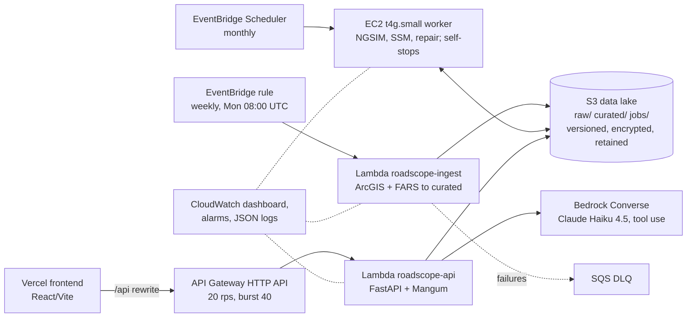

# RoadScope: a proactive road-safety portal for Lubbock County, Texas

RoadScope applies Highway Safety Manual (HSM) Part B network screening to the public TxDOT roadway, traffic and crash layers for Lubbock County. It fits a Negative Binomial safety performance function (SPF) with Empirical Bayes (EB) adjustment, summarises vulnerable-road-user (VRU) and fatal crashes, and computes surrogate safety measures (TTC, PET, DRAC) on real vehicle trajectories at two signalised intersections. For those trajectories it also benchmarks a constant-acceleration Kalman/RTS smoother against linear interpolation for repairing occluded tracks. Every number in the portal comes from a reproducible Python pipeline. The pipeline is served by a serverless AWS stack (S3, Lambda, EventBridge, EC2, API Gateway, Bedrock, CloudWatch), and each output carries its provenance, licence and stated limitations.

- Portal (production): https://roadscope-ai-demo.vercel.app
- API health: https://tkk01bgzfb.execute-api.us-east-2.amazonaws.com/api/v1/health (OpenAPI at `/api/v1/docs`)

## 1. Analysis questions and key results

| # | Question | Method | Output |
|---|---|---|---|
| 1 | Which segments show more crashes than expected for their exposure? | Crash rate, critical rate, NB SPF + EB excess | Ranked network screening |
| 2 | Where along a corridor do crashes, AADT, speed and cross-section change? | Straight-line diagram on TxDOT DFO | 7 corridors |
| 3 | Where and how are pedestrians, cyclists and scooter riders injured or killed? | KABCO breakdown of TxDOT active-transportation crashes; FARS 2018-2023 | VRU / fatal maps |
| 4 | What near-crash risk do intersections carry before any crash occurs? | TTC / PET / DRAC conflicts; occlusion repair | Intersection lab |

### 1.1 Network screening (395 of 443 one-mile segments screened; 823 segment crashes over a 9-year window)

Top segments ranked by EB excess (EB expected minus SPF predicted, crashes/yr):

| Segment | Route | AADT | Crashes (9 yr) | Rate (per 100 MVMT) | Rate / critical rate | SPF pred. (/yr) | EB expected (/yr) | EB excess (/yr) |
|---|---|---:|---:|---:|---:|---:|---:|---:|
| US0084-KG_01_070 | US 84 | 17,230 | 48 | 84.80 | 4.89 | 0.742 | 5.214 | **4.472** |
| FM2255-KG_007 | FM 2255 | 26,084 | 49 | 57.19 | 3.00 | 1.238 | 5.396 | **4.158** |
| US0062-KG_03_003 | US 62 | 17,700 | 39 | 67.07 | 3.89 | 0.785 | 4.246 | **3.461** |
| US0084-KG_01_069 | US 84 | 21,608 | 41 | 57.76 | 3.52 | 1.184 | 4.500 | **3.316** |
| US0082-KG_02_001 | US 82 | 39,879 | 22 | 16.79 | 2.63 | 0.459 | 2.296 | **1.837** |

### 1.2 Safety performance functions (`N = exp(b0) · AADT^b1 · L`, NB2 maximum likelihood)

| Group | Segments | Crashes | b0 (SE) | b1 (SE) | k | AIC |
|---|---:|---:|---|---|---:|---:|
| Pooled | 395 | 792 | -12.713 (1.082) | 1.227 (0.122) | 7.204 | 893.95 |
| Principal arterial | 94 | 371 | -20.401 (4.901) | 2.061 (0.522) | 5.601 | 351.98 |
| Minor arterial | 72 | 194 | -11.550 (3.662) | 1.157 (0.426) | 7.635 | 212.95 |
| Interstate/Freeway | 59 | 209 | -10.768 (4.133) | 0.943 (0.403) | 2.995 | 253.21 |
| Collector/Local | 170 | 18 | not fitted: too few crashes; pooled SPF used | | | |

### 1.3 Vulnerable road users and fatalities

- TxDOT active-transportation crashes: 307 (220 pedestrian, 78 bicycle, 9 scooter). KABCO: K 42, A 44, B 120, C 92, O 9, so **KA = 86**.
- NHTSA FARS 2018-2023, Lubbock County: **278 fatal crashes, 301 fatalities**.

### 1.4 Intersection conflicts (NGSIM, 10 Hz, 90 s windows)

| Site | Tracks | Rear-end | Crossing | Lane change | Total | Critical / serious / moderate |
|---|---:|---:|---:|---:|---:|---|
| Lankershim Blvd at Main St (Los Angeles, 2005-06-16) | 190 | 7 | 2 | 1 | 10 | 4 / 5 / 1 |
| Peachtree St at 10th St (Atlanta, 2006-11-08) | 170 | 28 | 18 | 3 | 49 | 39 / 6 / 4 |

### 1.5 Occlusion repair (held-out test gaps, position RMSE in m)

| Site | Occluded tracks / gaps / gap frames | Linear | KF-CA | KF-CA path frame (selected) | Selected q, r |
|---|---|---:|---:|---:|---|
| Lankershim | 36 / 54 / 1,028 | 0.408 | 0.079 | **0.078** | q_along 1e5, q_cross 2310, r 0.02 |
| Peachtree | 20 / 26 / 498 | 0.475 | 0.255 | **0.255** | q_along 8110, q_cross 1e5, r 0.05 |

Speed RMSE (m/s), linear vs selected method: Lankershim 0.443 vs 0.111; Peachtree 0.609 vs 0.280.

## 2. Data sources

| Source | Records | Licence | How fetched |
|---|---:|---|---|
| TxDOT AADT (`TxDOT_AADT/FeatureServer/0`) | 5,785 | (c) TxDOT, informational; attribution and disclaimer | ArcGIS REST, Lubbock envelope |
| TxDOT Roadway Inventory 2024 | 11,156 | (c) TxDOT, as above | ArcGIS REST |
| TxDOT Segment Crash Results | 443 | (c) TxDOT, as above | ArcGIS REST |
| TxDOT Statewide Speed 2024 | 2,738 | (c) TxDOT, as above | ArcGIS REST |
| TxDOT Active Transportation Crashes | 307 | (c) TxDOT, as above | ArcGIS REST |
| NHTSA FARS 2018-2023 (national CSV, filtered to Lubbock County) | 24 / 58 / 38 / 59 / 49 / 51 | Public domain (US Government work) | `static.nhtsa.gov` zip per year |
| NGSIM Lankershim | 55,554 rows | USDOT ITS DataHub, CC BY-SA 3.0 | SODA API `data.transportation.gov/resource/8ect-6jqj` |
| NGSIM Peachtree | 27,237 rows | USDOT ITS DataHub, CC BY-SA 3.0 | SODA API, as above |

Each source is recorded in `data/curated/manifest.json` with its URL, fetch time and SHA-256.

## 3. Methods

**Exposure, crash rate and critical rate** (HSM Part B; Y = 9 years, k = 1.645 for 95 %):

```
M   = 365 · Y · AADT · L / 1e8                  (100 million vehicle-miles)
R   = N / M                                     (crashes per 100 MVMT)
Rc  = Ra + k · sqrt(Ra / M) + 1 / (2M)          (Ra = mean rate of the functional-class group)
```

**Negative Binomial SPF and Empirical Bayes**:

```
ln mu = b0 + b1 · ln AADT + ln L + ln Y         (NB2 MLE, statsmodels; overdispersion k)
w     = 1 / (1 + k · mu)
E     = w · mu + (1 - w) · N                    (mu and N over the same period)
excess = E - mu                                 (reported per year)
```

Class-specific SPFs are fitted where a group has enough segments and crashes. Otherwise the pooled SPF is used. The weekly ingest Lambda reuses the stored coefficients and does not refit them.

**Surrogate safety measures** (10 Hz, Savitzky-Golay smoothed trajectories):

```
TTC  = gap / (v_f - v_l)          when closing;   conflict if TTC  <= 1.5 s
DRAC = (v_f - v_l)^2 / (2 · gap)                  conflict if DRAC >= 3.4 m/s^2
PET  = t_enter(B) - t_exit(A) over 2 m conflict-zone cells   conflict if PET <= 2.0 s
```

To suppress NGSIM artefacts, the detector requires a spacing of at least 1.0 m, a follower speed of at least 2.0 m/s and persistence of at least 3 frames. Conflicts are classified as rear-end, lane-change or crossing.

**Occlusion protocol and tuning.** Eligible tracks are split with a fixed seed (20251) into a test set and a validation set of up to 60 tracks. Synthetic gaps of 0.8 to 3.0 s are injected (at most 2 per track, 1.0 s margin), and 3.0 s of observed context is kept on each side. The constant-acceleration Kalman filter with Rauch-Tung-Striebel smoother uses state `[p, v, a]` and white-noise jerk with spectral density q. Its q (12 log-spaced values, 0.1 to 1e5) and r (0.02 to 0.2) are grid-searched on validation tracks only. The path-frame variant tunes q_along and q_cross by coordinate descent. The method with the lowest validation RMSE is then scored once on the test gaps against held-out truth.

## 4. Architecture



- An alternative edge (CloudFront with Origin Access Control in front of the Lambda Function URL, caching curated GETs for 300 s) is defined behind `cdk deploy -c edge=cloudfront`. It will be enabled once AWS account verification completes, which CloudFront requires. Until then the HTTP API edge is the default.
- While the account is under Bedrock verification, `POST /api/v1/ask` falls back to a deterministic tool router. The router runs the same data tools as the model and returns cited answers.
- Infrastructure is a single CDK stack, `infra/cdk/stacks/roadscope_stack.py`. Each function has its own least-privilege IAM role, and Bedrock access is scoped to the Haiku 4.5 inference profile.

## 5. Repository layout

```
pipeline/roadscope_pipeline/   network.py, spf.py, vru.py, fars.py, arcgis.py, build_network.py,
                               lambda_ingest.py, trajectory/{ngsim,ssm,repair,build}.py
pipeline/tests/                pipeline unit tests
backend/app/                   FastAPI service (routers, queries, Bedrock analyst, Lambda handler)
backend/tests/                 API tests with fixtures
frontend/                      React + Vite portal; vercel.json (rewrites, caching)
infra/cdk/                     AWS CDK (Python) stack
scripts/                       package_lambdas.sh, publish_data.sh, ec2_batch_job.sh, smoke tests
data/curated/                  data contract served by the API (see docs/SPEC.md)
docs/                          SPEC.md, DEPLOY.md
```

## 6. Local quick start

```bash
# Pipeline (Python 3.13)
python3.13 -m venv .venv && .venv/bin/pip install -r pipeline/requirements.txt
PYTHONPATH=pipeline .venv/bin/python -m roadscope_pipeline.build_network --out data/curated
PYTHONPATH=pipeline .venv/bin/python -m roadscope_pipeline.trajectory.build --out data/curated

# API (reads data/curated when DATA_BUCKET is unset)
cd backend && python3.13 -m venv .venv && .venv/bin/pip install -r requirements.txt
.venv/bin/uvicorn app.main:app --reload            # http://127.0.0.1:8000/api/v1/docs

# Frontend
cd frontend && npm ci && npm run dev               # http://localhost:5173
```

Tests:

```bash
PYTHONPATH=pipeline .venv/bin/python -m pytest -q pipeline/tests   # 12 tests
cd backend && .venv/bin/python -m pytest -q                         # 47 tests
```

Deployment is described in [docs/DEPLOY.md](docs/DEPLOY.md).

## 7. Limitations

- **`SUM_CRASH_` interpretation.** The TxDOT Segment Crash Results layer has no field description. Its values are all multiples of 1/9, so they are read as mean annual crashes over a 9-year window, and counts are recovered as N = round(9 · SUM_CRASH_). The publisher does not document the window years or the crash population (all severities or a subset).
- **No segment-level severity.** Without a KABCO split per segment, EPDO cannot be computed and is reported as null. Ranking therefore uses frequency-based measures only.
- **Linear referencing.** Segment measures are route-part offsets, not DFO. Endpoints are projected onto AADT route geometry, and attributes are joined by length-weighted DFO overlap.
- **NGSIM stands in for roadside LiDAR.** The trajectories come from video in California (2005) and Georgia (2006). They are not Lubbock data and not LiDAR point clouds. Their purpose is to demonstrate the conflict and repair methods on real 10 Hz trajectories.
- **Smoothed truth.** Repair RMSE is scored against Savitzky-Golay-smoothed NGSIM positions, not survey-grade ground truth. Absolute errors are therefore optimistic, but the ranking of methods is still informative.
- **Lankershim q optimum lies at the grid edge.** Validation RMSE is within 1 % of the optimum for every q from 28,500 to 1e5, the upper grid bound. The optimum is flat and not interior, so q is weakly identified there. At Peachtree the optimum (8,110) is interior.
- **Small conflict samples.** 10 and 49 events in 90 s windows illustrate the method. They are not site safety estimates.
- **TxDOT disclaimer.** TxDOT data are provided for informational purposes only. TxDOT makes no warranty as to their accuracy or completeness, and this project is not affiliated with or endorsed by TxDOT.

## 8. Relation to TransTech Lab work

The methods here are aligned with the following published work. This project has no affiliation with the lab.

- Igene, Luo et al., *Sensors* (2024): LiDAR-calibrated microsimulation combined with Negative Binomial crash models. RoadScope's NB SPF + EB screening follows the same modelling family.
- Luo et al., *Sensors* (2025): trajectory repair under occlusion for roadside sensing. The occlusion-injection and Kalman/RTS repair benchmark addresses the same problem.
- Zhang, Luo et al., *PLOS ONE* (2025): conflict-based proactive safety assessment. The TTC/PET/DRAC conflict extraction uses that framework.

## Author

Built by Hephaistos (GitHub [HEPHAISTOS89](https://github.com/HEPHAISTOS89)) as part of an application to the TransTech Lab Graduate Assistant position, Texas Tech University.
