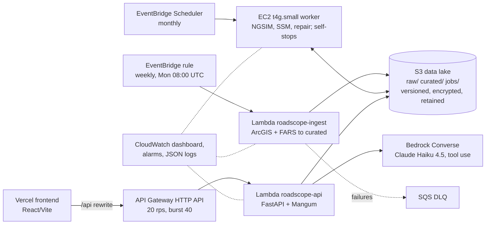

# RoadScope: a proactive road-safety portal for Lubbock County, Texas

RoadScope applies Highway Safety Manual (HSM) Part B network screening to the public TxDOT roadway, traffic and crash layers for Lubbock County. The screened outcome is **on-system pedestrian, cyclist and e-scooter crashes** (TxDOT CRIS, via the Active Transportation Crashes layer, 2021-2023, all KABCO severities) snapped to 443 one-mile segments. Negative Binomial safety performance functions (SPFs) are fitted by site type and combined with Empirical Bayes (EB) adjustment. The portal also summarises vulnerable-road-user (VRU) and fatal crashes, and computes FHWA SSAM surrogate safety measures (TTC, PET, DRAC) on real vehicle trajectories at two signalised intersections. For those trajectories it benchmarks a constant-acceleration Kalman/RTS smoother against linear interpolation for repairing occluded tracks, under two gap protocols and two ground truths. Every number in the portal comes from a reproducible Python pipeline. The pipeline is served by a serverless AWS stack (S3, Lambda, EventBridge, EC2, API Gateway, Bedrock, CloudWatch), and each output carries its provenance, licence and stated limitations.

- Portal (production): https://roadscope-ai-demo.vercel.app
- API health: https://tkk01bgzfb.execute-api.us-east-2.amazonaws.com/api/v1/health (OpenAPI at `/api/v1/docs`)

## 1. Analysis questions and key results

| # | Question | Method | Output |
|---|---|---|---|
| 1 | Which state-system segments show more pedestrian/cyclist crashes than expected for their exposure? | Crash rate, critical rate, site-type NB SPF + EB excess | Ranked ped/bike network screening |
| 2 | Where along a corridor do ped/bike crashes, AADT, speed and cross-section change? | Straight-line diagram on TxDOT DFO | 7 corridors |
| 3 | Where and how are pedestrians, cyclists and scooter riders injured or killed? | KABCO and PBCAT breakdown of TxDOT CRIS active-transportation crashes; FARS 2018-2023 | VRU / fatal maps |
| 4 | What near-crash risk do intersections carry before any crash occurs? | SSAM TTC / PET conflicts with DRAC flag; occlusion repair | Intersection lab |

### 1.1 Network screening (ped/bike crashes 2021-2023, Y = 3)

443 one-mile segments; 395 have AADT and a site type and are screened. **114 on-system ped/bike crashes** are snapped to segments (100 % of on-system points within 5 m; 193 off-system crashes excluded); 110 fall on the 395 screened segments, and 64 segments have at least one crash. Five segments have an EB excess above 0.25 crashes/yr.

Top segments by EB excess (EB expected minus SPF predicted, ped/bike crashes/yr):

| Segment | Route | Site type | AADT | Crashes 2021-23 | of which KA | Rate (per 100 MVMT) | R / Rc | SPF pred. (/yr) | EB expected (/yr) | EB excess (/yr) |
|---|---|---|---:|---:|---:|---:|---:|---:|---:|---:|
| US0084-KG_01_070 | US 84 | Urban principal arterial | 17,230 | 9 | 1 | 47.7 | 2.82 | 0.57 | 2.11 | **1.55** |
| US0062-KG_03_003 | US 62 | Urban principal arterial | 17,700 | 7 | 2 | 36.1 | 2.16 | 1.09 | 2.05 | **0.96** |
| US0084-KG_01_071 | US 84 | Urban principal arterial | 12,711 | 5 | 1 | 35.9 | 1.86 | 0.41 | 1.11 | **0.70** |
| US0084-KG_01_069 | US 84 | Urban principal arterial | 21,608 | 5 | 2 | 21.1 | 1.37 | 0.72 | 1.37 | **0.65** |
| FM2255-KG_007 | FM 2255 | Urban minor arterial | 26,084 | 6 | 1 | 21.0 | 1.50 | 1.00 | 1.29 | **0.29** |

### 1.2 Safety performance functions (NB2 ML, offset ln L + ln Y, k per mile)

Site types are Roadway Inventory urban/rural × functional-class group. A site type gets its own SPF if it has at least 30 segments and 20 crashes; its covariates are chosen by AIC with at most one covariate per 10 crashes. The others use a pooled site-type fallback model. GOF columns: mean absolute deviation (MAD), Pearson χ²/df, and the share of the CURE curve outside ±2σ*.

| Site type | Segments | Crashes | Model (coef ± SE) | k ± SE (/mi) | MAD | χ²/df | CURE outside |
|---|---:|---:|---|---:|---:|---:|---:|
| Urban interstate/freeway | 58 | 28 | const -11.926 ± 3.593; ln AADT 0.973 ± 0.340 | 0.0005 ± 0.026 | 0.494 | 1.38 | 1.7 % |
| Urban principal arterial | 75 | 56 | const -8.223 ± 4.530; ln AADT 1.071 ± 0.447; speed -0.062 ± 0.017 | 1.025 ± 0.514 | 0.786 | 0.83 | 22.7 % |
| Urban minor arterial | 55 | 24 | const -4.565 ± 2.766; ln AADT -0.095 ± 0.359; lanes 0.922 ± 0.212 | 0.139 ± 0.330 | 0.424 | 1.05 | 12.7 % |
| Urban collector/local | 39 | 0 | fallback | | 0.068 | 0.07 | 89.7 % |
| Rural interstate/freeway | 1 | 0 | fallback | | 0.032 | 0.03 | 100 % |
| Rural principal arterial | 19 | 0 | fallback | | 0.035 | 0.05 | 84.2 % |
| Rural minor arterial | 17 | 0 | fallback | | 0.017 | 0.03 | 82.4 % |
| Rural collector/local | 131 | 2 | fallback | | 0.023 | 2.57 | 54.2 % |
| *Fallback (all 395)* | 395 | 110 | const -5.505 ± 1.434; ln AADT 0.274 ± 0.178; urban 1.848 ± 0.765; lanes 0.485 ± 0.132; speed -0.049 ± 0.012 | 0.641 ± 0.274 | | | |
| *Pooled ln AADT only (reference)* | 395 | 110 | const -11.756 ± 1.352; ln AADT 1.032 ± 0.144 | 2.352 | 0.390 | 0.99 | 32.4 % |
| *System (site-type SPFs as used)* | 395 | 110 | | | 0.298 | 1.32 | 24.3 % |

GOF on the fallback site types is not informative (0-2 crashes); their CURE curves drift outside ±2σ* because all residuals are negative.

### 1.3 Vulnerable road users and fatalities

- TxDOT CRIS active-transportation crashes, 2021-2023, countywide (on and off system): 307 (220 pedestrian, 78 bicycle, 9 scooter). KABCO: K 42, A 44, B 120, C 92, O 9, so **KA = 86**. 114 are on the state system and form the screening outcome. The most frequent PBCAT type is *Pedestrian Failed To Yield* (100).
- NHTSA FARS 2018-2023, Lubbock County: **278 fatal crashes, 301 fatalities**.

### 1.4 Intersection conflicts (NGSIM, 10 Hz, 90 s windows, FHWA SSAM detection)

| Site | Tracks | Rear-end | Crossing (PET) | Lane change | Total | Critical / serious / moderate | Overlap (PET = 0) | DRAC ≥ 3.4 m/s² |
|---|---:|---:|---:|---:|---:|---|---:|---:|
| Lankershim Blvd at Main St (Los Angeles, 2005-06-16) | 190 | 6 | 17 | 0 | 23 | 1 / 7 / 15 | 0 | 1 |
| Peachtree St at 10th St (Atlanta, 2006-11-08) | 170 | 28 | 88 | 3 | 119 | 51 / 26 / 42 | 17 | 22 |

The 17 Peachtree overlaps (both footprints in the conflict zone at once) are kept and flagged; at NGSIM position accuracy they are most likely data errors, not near-collisions. Excluding them leaves 71 crossing conflicts at PET ≤ 5.0 s.

### 1.5 Occlusion repair (held-out test gaps, position RMSE in m)

Two gap protocols × two truths. *Uniform*: seeded random gaps of 0.5-5.0 s. *Occluder*: real 2D line-of-sight occlusion intervals (0.5-5.0 s) from a virtual roadside sensor. *Smoothed* truth: Savitzky-Golay NGSIM positions; *raw* truth: unsmoothed NGSIM positions.

| Site | Protocol | Truth | Gaps | Linear | KF-CA | KF-CA path | < 2 s lin / KF | ≥ 2 s lin / KF |
|---|---|---|---:|---:|---:|---:|---|---|
| Lankershim | uniform | smoothed | 54 | 1.028 | 0.380 | **0.361** | 0.29 / 0.23 | 1.12 / 0.40 |
| Lankershim | uniform | raw | 54 | 1.029 | **0.388** | **0.388** | 0.31 / 0.23 | 1.12 / 0.41 |
| Lankershim | occluder | smoothed | 171 | 0.527 | 0.276 | **0.259** | 0.22 / 0.13 | 0.95 / 0.48 |
| Lankershim | occluder | raw | 171 | 0.534 | 0.317 | **0.315** | 0.24 / 0.20 | 0.95 / 0.52 |
| Peachtree | uniform | smoothed | 22 | 1.633 | **1.234** | 1.235 | 0.24 / 0.06 | 1.80 / 1.36 |
| Peachtree | uniform | raw | 22 | 1.634 | **1.085** | 1.122 | **0.23** / 0.31 | 1.80 / 1.19 |
| Peachtree | occluder | smoothed | 94 | 0.682 | **0.376** | **0.376** | 0.13 / 0.06 | 1.02 / 0.56 |
| Peachtree | occluder | raw | 94 | 0.682 | **0.292** | 0.308 | **0.14** / 0.16 | 1.02 / 0.40 |

Short/long columns pool the by-gap bins (gap-frame-weighted RMSE). Against raw truth, gaps under 2 s are a tie or a linear win at Peachtree and a narrow Kalman win at Lankershim. From 2 s up, the Kalman smoother is better in all eight cases, by 1.3-2.8× (1.8-2.8× at Lankershim). Against smoothed truth Kalman also wins on short gaps, partly because the smoothing window spreads in-gap information into the context. Speed is scored against smoothed truth only (uniform protocol, linear vs selected: Lankershim 0.720 vs 0.273 m/s; Peachtree 1.314 vs 1.156 m/s).

## 2. Data sources

| Source | Records | Licence | How fetched |
|---|---:|---|---|
| TxDOT AADT (`TxDOT_AADT/FeatureServer/0`) | 5,785 | (c) TxDOT, informational; attribution and disclaimer | ArcGIS REST, Lubbock envelope |
| TxDOT Roadway Inventory 2024 | 11,156 | (c) TxDOT, as above | ArcGIS REST |
| TxDOT Segment Crash Results (SATP; one-mile segment geometry, `SUM_CRASH_` kept only as `satp_crash_score`) | 443 | (c) TxDOT, as above | ArcGIS REST |
| TxDOT Statewide Speed 2024 | 2,738 | (c) TxDOT, as above | ArcGIS REST |
| TxDOT Active Transportation Crashes (CRIS, 2021-2023; screening outcome = 114 on-system) | 307 | (c) TxDOT, as above | ArcGIS REST |
| NHTSA FARS 2018-2023 (national CSV, filtered to Lubbock County) | 24 / 58 / 38 / 59 / 49 / 51 | Public domain (US Government work) | `static.nhtsa.gov` zip per year |
| NGSIM Lankershim | 55,554 rows | USDOT ITS DataHub, CC BY-SA 3.0 | SODA API `data.transportation.gov/resource/8ect-6jqj` |
| NGSIM Peachtree | 27,237 rows | USDOT ITS DataHub, CC BY-SA 3.0 | SODA API, as above |

Each source is recorded in `data/curated/manifest.json` with its URL, fetch time and SHA-256.

## 3. Methods

**Outcome.** On-system pedestrian, cyclist and e-scooter crashes, all KABCO severities, from TxDOT CRIS via the Active Transportation Crashes layer, 2021-2023 (Y = 3). Crash points are snapped to segment polylines (≤ 5 m), so crash matching does not depend on DFO or route-name joins.

**Exposure, crash rate and critical rate** (HSM Part B; Y = 3 years, k = 1.645 for 95 %):

```
M   = 365 · Y · AADT · L / 1e8                  (100 million vehicle-miles)
R   = N / M                                     (crashes per 100 MVMT)
Rc  = Ra + k · sqrt(Ra / M) + 1 / (2M)          (Ra = exposure-weighted mean rate of the site type)
```

**Site-type Negative Binomial SPFs and Empirical Bayes**:

```
ln mu_Y = b0 + b1 · ln AADT + sum_j b_j · x_j + ln L + ln Y
                 (NB2 MLE, scipy L-BFGS-B, SE from the numerical Hessian;
                  x_j in {lanes, divided, posted speed}, AIC-selected, <= 1 covariate per 10 crashes)
k_seg  = k / L                                  (k per mile; HSM Part C segment convention)
w      = 1 / (1 + k_seg · mu_Y)
E      = w · mu_Y + (1 - w) · N                 (mu_Y and N over the same 3-year period)
excess = (E - mu_Y) / Y                         (ped/bike crashes per year)
```

Site types with fewer than 30 segments or 20 crashes use a pooled site-type model (ln AADT, urban, lanes, speed). Goodness of fit: MAD, Pearson χ²/df and CURE plots with ±2σ* bounds (Hauer and Bamfo 1997). EPDO is not computed (no sourced severity weights; `epdo` is null). The weekly ingest Lambda reuses the stored coefficients and does not refit them.

**Surrogate safety measures** (10 Hz, Savitzky-Golay smoothed trajectories; FHWA SSAM detection thresholds, Gettman et al. 2008):

```
TTC  = gap / (v_f - v_l) when v_f > v_l      rear-end / lane-change event if TTC <= 1.5 s for >= 0.3 s
PET  = t(front of 2nd enters zone) - t(rear of 1st leaves zone)
       zone = intersection of the two swept length x width footprints (0.5 m raster, 50 Hz),
       conflicting approaches >= 30 deg      crossing event if PET <= 5.0 s
DRAC = (v_f - v_l)^2 / (2 · gap)             flag if DRAC_max >= 3.4 m/s^2 (11.2 ft/s^2, AASHTO 2018); not a detection criterion
```

Severity bins are study-specific: TTC ≤ 0.5 s critical, 0.5-1.0 s serious, 1.0-1.5 s moderate; PET ≤ 1 s critical, 1-2.5 s serious, 2.5-5 s moderate (there is no FHWA/SSAM PET severity standard). Both footprints inside the zone at once is recorded as PET = 0 with `overlap = true`. To suppress NGSIM artefacts, the TTC detector requires a gap of at least 1 m, a follower speed of at least 2 m/s, and a closing rate consistent with the change in spacing. Each site's `intersections/<id>_ssm.json` holds the rules as run, their citations, and threshold-sensitivity counts.

**Occlusion protocols and tuning.** *Uniform*: seeded (20251) random gaps of 0.5-5.0 s, 1-2 per track, at least 1.0 s from the track ends. *Occluder*: a virtual sensor at (-12 m, 12 m), 4.5 m high but modelled in 2D. A track is occluded while a nearer vehicle footprint lies on the sensor ray. Intervals of 0.5-5.0 s are kept and visible flickers of ≤ 2 frames are merged; this hides about 71-72 % of frames. Each protocol is scored against smoothed and raw truth. In the raw case, NGSIM-interpolated frames are excluded. Tracks with a 0.1 s jump above 5 m are not scored (0 at Lankershim, 8 at Peachtree) but still occlude others. The constant-acceleration Kalman filter with Rauch-Tung-Striebel smoother uses state `[p, v, a]` and white-noise jerk with spectral density q. Its q (12 log-spaced values, 0.1 to 1e5) and r (0.02 to 0.2) are grid-searched on validation tracks only (up to 60), with 3.0 s of observed context on each side. The path-frame variant tunes q_along and q_cross separately. The method with the lowest validation RMSE is then scored once on the test gaps (Punzo et al. 2011 and Montanino and Punzo 2015 describe NGSIM error and its reconstruction).

## 4. Architecture



- An alternative edge (CloudFront with Origin Access Control in front of the Lambda Function URL, caching curated GETs for 300 s) is defined behind `cdk deploy -c edge=cloudfront`. It will be enabled once AWS account verification completes, which CloudFront requires. Until then the HTTP API edge is the default.
- While the account is under Bedrock verification, `POST /api/v1/ask` falls back to a deterministic tool router. The router runs the same data tools as the model and returns cited answers.
- Infrastructure is a single CDK stack, `infra/cdk/stacks/roadscope_stack.py`. Each function has its own least-privilege IAM role, and Bedrock access is scoped to the Haiku 4.5 inference profile.

## 5. Repository layout

```
pipeline/roadscope_pipeline/   network.py, spf.py, vru.py, fars.py, arcgis.py, build_network.py,
                               lambda_ingest.py, trajectory/{ngsim,ssm,repair,build}.py
pipeline/tests/                pipeline unit tests
backend/app/                   FastAPI service (routers, queries, Bedrock analyst, Lambda handler)
backend/tests/                 API tests with fixtures
frontend/                      React + Vite portal; vercel.json (rewrites, caching)
infra/cdk/                     AWS CDK (Python) stack
scripts/                       package_lambdas.sh, publish_data.sh, ec2_batch_job.sh, smoke tests
data/curated/                  data contract served by the API (see docs/SPEC.md)
docs/                          SPEC.md, DEPLOY.md
```

## 6. Local quick start

```bash
# Pipeline (Python 3.13)
python3.13 -m venv .venv && .venv/bin/pip install -r pipeline/requirements.txt
PYTHONPATH=pipeline .venv/bin/python -m roadscope_pipeline.build_network --out data/curated
PYTHONPATH=pipeline .venv/bin/python -m roadscope_pipeline.trajectory.build --out data/curated

# API (reads data/curated when DATA_BUCKET is unset)
cd backend && python3.13 -m venv .venv && .venv/bin/pip install -r requirements.txt
.venv/bin/uvicorn app.main:app --reload            # http://127.0.0.1:8000/api/v1/docs

# Frontend
cd frontend && npm ci && npm run dev               # http://localhost:5173
```

Tests:

```bash
PYTHONPATH=pipeline .venv/bin/python -m pytest -q pipeline/tests   # 22 tests
cd backend && .venv/bin/python -m pytest -q                         # 48 tests
```

Deployment is described in [docs/DEPLOY.md](docs/DEPLOY.md).

## 7. Limitations

- **`SUM_CRASH_` is not a crash count.** The TxDOT Segment Crash Results field is undocumented: the item has no description, its field aliases equal the field names, and no years are stated. It is published only in the TxDOT SATP (Statewide Active Transportation Plan) web map. Against the CRIS ped/bike crashes snapped to the same segments it correlates at r = 0.945, and a least-squares fit gives K/A/B crashes about ten times the weight of C/O crashes (R² = 0.946). It is therefore an injury-weighted pedestrian/cyclist score for 2021-2023. It is not a 9-year all-crash mean, which is how an earlier version of this project read it. It is kept only as `satp_crash_score`, and the evidence is in `spf.json → diagnostics.crash_field`.
- **Ped/bike only.** Vehicle-only crashes are not in the screening outcome. An all-crash screening needs the full CRIS crash records, which are not public as a layer.
- **AADT count year.** `TxDOT_AADT.AADT_CUR` has no published count year. It differs from the Roadway Inventory 2024 ADT on most on-system records, so the exposure is presumably a later count than the 2021-2023 crash period.
- **Sparse site types.** Only three urban site types have their own SPF. The five others, including every rural type, have 0-2 crashes, so they use the pooled fallback model and their EB estimates rest almost entirely on it. Standard errors on the fitted site types are wide (24-56 crashes each). The urban minor arterial ln AADT coefficient cannot be distinguished from zero, and the urban freeway k is close to 0.
- **No segment-level severity weights.** EPDO is reported as null. Severity analysis is confined to the VRU and FARS layers.
- **Linear referencing.** Segment measures are route-part offsets, not DFO. Endpoints are projected onto AADT route geometry, and attributes are joined by length-weighted DFO overlap. 48 segments (SL 88, FM 2130 and others) have no inventory match and are not screened.
- **NGSIM stands in for roadside LiDAR.** The trajectories come from video in California (2005) and Georgia (2006). They are not Lubbock data and not LiDAR point clouds. Their purpose is to demonstrate the conflict and repair methods on real 10 Hz trajectories.
- **Repair truth and occluder geometry.** Smoothed truth favours smooth models. Raw truth carries NGSIM measurement noise, which sets a floor on achievable RMSE. The occluder protocol is 2D, so it over-states occlusion relative to a 4.5 m pole: it is a realistic way to place gaps, not a LiDAR visibility model. One tuning optimum, Lankershim occluder/raw, lies on the q grid edge.
- **Small conflict samples.** 23 and 119 events in 90 s windows illustrate the method. They are not site safety estimates.
- **TxDOT disclaimer.** TxDOT data are provided for informational purposes only. TxDOT makes no warranty as to their accuracy or completeness, and this project is not affiliated with or endorsed by TxDOT.

## 8. Relation to TransTech Lab work

The methods here are aligned with the following published work. This project has no affiliation with the lab.

- Igene, Luo et al., *Sensors* (2024): LiDAR-calibrated microsimulation combined with Negative Binomial crash models. RoadScope's site-type NB SPF + EB screening follows the same modelling family.
- Luo et al., *Sensors* (2025): vehicle trajectory repair under full occlusion with roadside LiDAR. The occluder-protocol benchmark addresses the same problem with a generic Kalman/RTS baseline; it does not reproduce that method.
- Zhang, Luo et al., *PLOS ONE* (2025): anchor-free real-time vehicle tracking with LiDAR data, the tracking stage that produces the roadside-LiDAR trajectories that conflict and repair methods consume (NGSIM video trajectories stand in for them here).
- Pedestrian failure-to-yield research: the ped/bike screening and the PBCAT breakdown (where *Pedestrian Failed To Yield* is the most frequent type) give a county-level siting layer for that kind of countermeasure work.

## Author

Built by Hephaistos (GitHub [HEPHAISTOS89](https://github.com/HEPHAISTOS89)) as part of an application to the TransTech Lab Graduate Assistant position, Texas Tech University.
